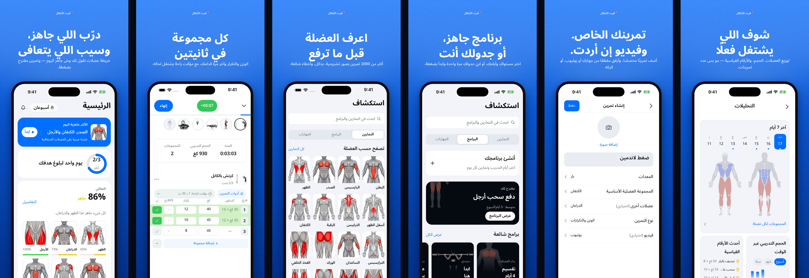

<h1 align="center">FitAbtal</h1>

<b>Your gym workouts, tracked and planned — in Arabic and English.</b>

<b>Free — track all your workouts without paying a thing.</b>

iPhone · Apple Watch · Light & Dark themes

<a href="https://apps.apple.com/sa/app/%D9%81%D9%8A%D8%AA-%D8%A7%D9%84%D8%A3%D8%A8%D8%B7%D8%A7%D9%84-%D9%85%D8%AA%D8%AA%D8%A8%D8%B9-%D8%A7%D9%84%D8%AA%D9%85%D8%A7%D8%B1%D9%8A%D9%86/id6830518286?l=ar"><b>⬇️ Download on the App Store · حمّل التطبيق من App Store</b></a>

---

## Screenshots

## Features

- Large exercise library with video demos and target muscles
- Workout logging: sets, reps, weight and rest timer
- Ready-made programs and custom routines
- Progress charts and personal records
- Apple Watch companion
- Full Arabic (RTL) and English support, light and dark themes
- **PRO** (optional): advanced features and calculators

## Promo videos

- [English launch video](media/fitabtal-appstore-launch-en.mp4)
- [Arabic promo video](media/fitabtal-promo-ar.mp4)

---

## فت أبطال

تطبيق لتتبّع وتخطيط تمارين النادي، بالعربية والإنجليزية.

**التطبيق مجاني، وما تحتاج تدفع ولا ريال عشان تسجّل تمارينك.**

- مكتبة تمارين كبيرة مع فيديوهات وشرح العضلات المستهدفة
- تسجيل التمارين: المجموعات والتكرارات والأوزان ومؤقت الراحة
- برامج جاهزة وروتينات مخصصة
- رسوم بيانية للتقدّم والأرقام القياسية
- تطبيق Apple Watch
- دعم كامل للعربية والإنجليزية، ووضع فاتح وداكن

**[حمّل التطبيق من App Store](https://apps.apple.com/sa/app/%D9%81%D9%8A%D8%AA-%D8%A7%D9%84%D8%A3%D8%A8%D8%B7%D8%A7%D9%84-%D9%85%D8%AA%D8%AA%D8%A8%D8%B9-%D8%A7%D9%84%D8%AA%D9%85%D8%A7%D8%B1%D9%8A%D9%86/id6830518286?l=ar)**

### الكلمات المفتاحية

تمارين · جيم · نادي رياضي · لياقة بدنية · كمال أجسام · رفع أثقال · تضخيم · بناء العضلات · تمارين القوة · تسجيل التمارين · مجموعات وتكرارات · مؤقت الراحة · جدول تمارين · برنامج تمارين · روتين تمارين · أرقام قياسية · حاسبة الوزن الأقصى · تقدّم · قياسات الجسم · اختبار اللياقة · صدر · ظهر · أكتاف · ذراع · باي · تراي · أرجل · أرداف · بطن · دمبل · بار · أجهزة · تمارين بوزن الجسم · تمارين منزلية · ساعة أبل · تطبيق تمارين مجاني

---

## Keywords

workout tracker · gym log · fitness app · exercise library · strength training · weightlifting · bodybuilding · powerlifting · muscle building · hypertrophy · sets and reps · rest timer · workout planner · training program · routines · personal records · 1RM calculator · progressive overload · progress tracking · body measurements · fitness test · chest · back · shoulders · arms · biceps · triceps · legs · glutes · abs · core · dumbbell · barbell · machines · bodyweight · home workout · Apple Watch workout · free workout app

## Privacy

[Privacy policy (English)](PRIVACY-en.md) · [سياسة الخصوصية](PRIVACY-ar.md)

> This repository is a showcase only. The app's source code is private.

© 2026 FitAbtal. All rights reserved.
