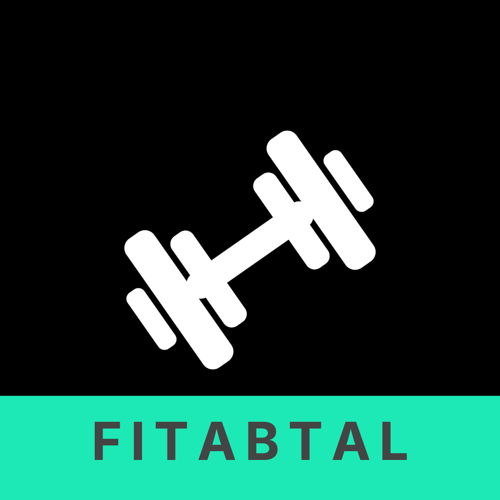
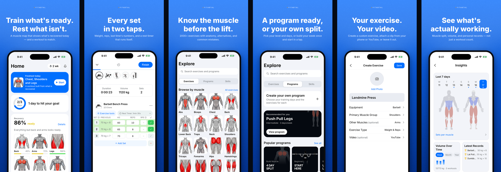

<h1 align="center">FitAbtal</h1>

<b>Your gym workouts, tracked and planned — in Arabic and English.</b>

iPhone · Apple Watch · Light & Dark themes

---

## Screenshots

## Features

- Large exercise library with video demos and target muscles
- Workout logging: sets, reps, weight and rest timer
- Ready-made programs and custom routines
- Progress charts and personal records
- Apple Watch companion
- Full Arabic (RTL) and English support, light and dark themes
- **PRO**: advanced features and calculators

## Promo videos

- [English launch video](media/fitabtal-appstore-launch-en.mp4)
- [Arabic promo video](media/fitabtal-promo-ar.mp4)

---

## فت أبطال

تطبيق لتتبّع وتخطيط تمارين النادي، بالعربية والإنجليزية.

- مكتبة تمارين كبيرة مع فيديوهات وشرح العضلات المستهدفة
- تسجيل التمارين: المجموعات والتكرارات والأوزان ومؤقت الراحة
- برامج جاهزة وروتينات مخصصة
- رسوم بيانية للتقدّم والأرقام القياسية
- تطبيق Apple Watch
- دعم كامل للعربية والإنجليزية، ووضع فاتح وداكن

---

## Privacy

[Privacy policy (English)](PRIVACY-en.md) · [سياسة الخصوصية](PRIVACY-ar.md)

> This repository is a showcase only. The app's source code is private.

© 2026 FitAbtal. All rights reserved.
